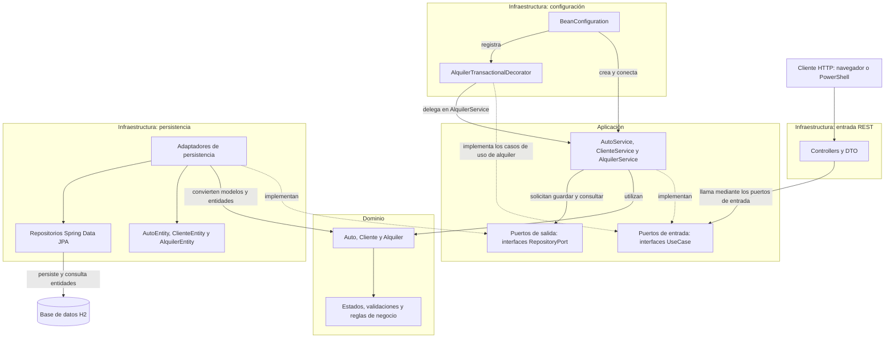

# AutoRent — Sistema de Alquiler de Autos

Proyecto académico de backend para registrar autos y clientes,
crear alquileres, consultar información y finalizar alquileres.

La aplicación utiliza arquitectura hexagonal para separar
las reglas del negocio de HTTP y de la persistencia.

## Integrantes

[Escribe aquí los nombres]

## Tecnologías

- Java: proyecto configurado para Java 27.
- Spring Boot 4.1.1.
- Maven.
- Spring Web MVC.
- Spring Data JPA.
- Jakarta Validation.
- H2 en memoria.
- IntelliJ IDEA como entorno de desarrollo.

## Cómo ejecutar

1. Abrir la carpeta del proyecto en IntelliJ IDEA.
2. Configurar el JDK del proyecto y de ejecución en Java 27.
3. Esperar a que Maven descargue las dependencias.
4. Ejecutar la clase `com.autorent.AutorentApplication`.
5. Comprobar en la consola el mensaje `Started AutorentApplication`.

La API utiliza la dirección base:

http://localhost:8080

El puerto 8080 debe estar disponible.

## Base de datos H2

Con la aplicación ejecutándose, abrir:

http://localhost:8080/h2-console

Datos de conexión:

- Driver Class: `org.h2.Driver`
- JDBC URL: `jdbc:h2:mem:autorent`
- User Name: `sa`
- Password: vacío

La base de datos es temporal: los registros se pierden al detener
la aplicación. Las tablas se crean nuevamente al iniciarla.

Consultas de ejemplo:

```sql
SELECT * FROM autos;
SELECT * FROM clientes;
SELECT * FROM alquileres;
```

## Arquitectura

### Dominio

Paquete: `com.autorent.domain`

Contiene los modelos `Auto`, `Cliente` y `Alquiler`,
sus estados y las excepciones del negocio.

Aplica reglas como comprobar la disponibilidad del auto,
calcular el valor del alquiler e impedir una segunda finalización.

No depende de Spring, JPA ni H2.

### Aplicación

Paquete: `com.autorent.application`

Contiene:

- Puertos de entrada: interfaces de los casos de uso.
- Puertos de salida: interfaces para solicitar persistencia.
- Servicios: coordinan las operaciones del negocio.

Los servicios utilizan los puertos de salida y no acceden
directamente a `JpaRepository`.

### Infraestructura

Paquete: `com.autorent.infrastructure`

Contiene:

- Controllers REST.
- DTO de solicitudes y respuestas.
- Manejador de excepciones.
- Entidades JPA.
- Repositorios Spring Data JPA.
- Adaptadores de persistencia.
- Configuración de beans y transacciones.

Los adaptadores convierten entre los modelos del dominio
y las entidades de persistencia.

`AlquilerTransactionalDecorator` aplica una transacción a la creación
y finalización de alquileres para guardar juntos los cambios
del auto y del alquiler.

## Flujo de creación de un alquiler

1. `AlquilerController` recibe la solicitud HTTP.
2. Delega en el puerto `CrearAlquilerUseCase`.
3. El decorador transaccional llama a `AlquilerService`.
4. El servicio busca el cliente y el auto mediante los puertos de salida.
5. Los adaptadores consultan los repositorios JPA y H2.
6. El dominio valida las condiciones, calcula el total y cambia
   el auto a `ALQUILADO`.
7. Se guardan el auto y el alquiler dentro de la misma transacción.
8. El controller devuelve un DTO con estado HTTP `201 Created`.

## Endpoints

| Método | Ruta | Operación |
|---|---|---|
| POST | `/api/autos` | Registrar auto |
| GET | `/api/autos/{id}` | Consultar auto |
| GET | `/api/autos/disponibles` | Listar autos disponibles |
| POST | `/api/clientes` | Registrar cliente |
| GET | `/api/clientes/{id}` | Consultar cliente |
| POST | `/api/alquileres` | Crear alquiler |
| GET | `/api/alquileres/{id}` | Consultar alquiler |
| PUT | `/api/alquileres/{id}/finalizar` | Finalizar alquiler |

Las operaciones POST reciben JSON con
`Content-Type: application/json`.

La finalización no requiere un cuerpo JSON.

## Reglas de negocio

1. Un auto nuevo comienza como `DISPONIBLE`.
2. Solo se pueden alquilar autos disponibles.
3. Un auto `ALQUILADO` o en `MANTENIMIENTO` no se puede alquilar.
4. Al crear un alquiler, el auto pasa a `ALQUILADO`.
5. Al finalizarlo, el auto vuelve a `DISPONIBLE`.
6. Un alquiler no puede finalizarse dos veces.
7. La cantidad de días debe ser mayor que cero.
8. El total se calcula como `precioPorDia × cantidadDias`.
9. El cliente y el auto deben existir.
10. El documento del cliente no puede repetirse.

## Validaciones

### Auto

- Placa, marca y modelo obligatorios.
- Año obligatorio y mayor o igual a 1900.
- Precio por día obligatorio y mayor que cero.
- La API admite hasta dos decimales en el precio.

### Cliente

- Nombre y documento obligatorios.
- Correo obligatorio y con formato válido.
- Documento único.
- Teléfono opcional.

### Alquiler

- Identificadores de cliente y auto obligatorios y positivos.
- Cantidad de días obligatoria y positiva.
- Existencia del cliente y del auto.
- Disponibilidad del auto.

## Ejemplos de solicitudes

### Registrar un auto

`POST /api/autos`

```json
{
  "placa": "XYZ789",
  "marca": "Renault",
  "modelo": "Logan",
  "anio": 2025,
  "precioPorDia": 150000
}
```

Ejemplo de respuesta — `201 Created`:

```json
{
  "id": 1,
  "placa": "XYZ789",
  "marca": "Renault",
  "modelo": "Logan",
  "anio": 2025,
  "precioPorDia": 150000.00,
  "estado": "DISPONIBLE"
}
```

### Registrar un cliente

`POST /api/clientes`

```json
{
  "nombre": "Ana Torres",
  "documento": "987654321",
  "telefono": "3009876543",
  "email": "ana@example.com"
}
```

### Crear un alquiler

`POST /api/alquileres`

Usar los identificadores devueltos al registrar el cliente y el auto.

```json
{
  "clienteId": 1,
  "autoId": 1,
  "cantidadDias": 5
}
```

Ejemplo de respuesta — `201 Created`:

```json
{
  "id": 1,
  "clienteId": 1,
  "autoId": 1,
  "fechaInicio": "2026-10-17",
  "fechaFin": "2026-10-22",
  "cantidadDias": 5,
  "valorTotal": 750000.00,
  "estado": "ACTIVO"
}
```

Los identificadores y las fechas pueden variar.
La fecha de inicio se obtiene de la fecha actual del sistema.
La fecha de fin se calcula sumando los días contratados.

## Respuestas de error

| Estado HTTP | Situación |
|---|---|
| 400 Bad Request | Datos inválidos o solicitud mal formada |
| 404 Not Found | Auto, cliente o alquiler inexistente |
| 409 Conflict | Auto no disponible, alquiler ya finalizado o documento duplicado |

Ejemplo al consultar un auto inexistente:

```json
{
  "timestamp": "2026-10-17T18:00:00",
  "status": 404,
  "error": "Not Found",
  "mensaje": "No se encontró un auto con el identificador 999999",
  "detalles": []
}
```

## Pruebas manuales realizadas

- Registrar y consultar un auto.
- Consultar autos disponibles.
- Registrar y consultar un cliente.
- Crear y consultar un alquiler.
- Comprobar el cálculo del total y las fechas.
- Comprobar el cambio del auto a `ALQUILADO`.
- Rechazar un nuevo alquiler del auto ocupado.
- Finalizar el alquiler.
- Comprobar el retorno del auto a `DISPONIBLE`.
- Rechazar una segunda finalización.
- Rechazar alquileres con cero días.
- Rechazar documentos duplicados y correos inválidos.
- Rechazar el alquiler de un auto en mantenimiento.
- Rechazar placa, marca, modelo, nombre y documento vacíos.
- Rechazar un precio por día igual a cero.
- Rechazar alquileres con cliente o auto inexistente.
- Verificar registros en la consola H2.

Para preparar la prueba de mantenimiento se modificó el estado
del auto directamente en H2. No existe un endpoint para cambiarlo
a mantenimiento.

## Evidencias

Las capturas de las pruebas se encuentran en `docs/evidencias/`.

Las pruebas descritas son manuales; no equivalen a una suite
de pruebas automatizadas.
//////////////////////////////////////////////////////////////////////////////////////////////////////////////////
## Diagrama de arquitectura

Las flechas representan llamadas entre componentes.
Las líneas punteadas indican qué interfaces implementa cada clase.



### Cómo interpretar el diagrama

- Los controllers reciben solicitudes HTTP y llaman a los puertos de entrada.
- Los servicios implementan los casos de uso y coordinan las operaciones.
- El dominio contiene los modelos y las reglas del negocio.
- Los servicios solicitan persistencia mediante los puertos de salida.
- Los adaptadores implementan esos puertos y convierten entre dominio y entidades JPA.
- Los repositorios JPA permiten almacenar y consultar las entidades en H2.
- La configuración conecta los componentes.
- El decorador aplica transacciones a las operaciones de alquiler.

### Dirección de las dependencias del código

- Aplicación depende del dominio.
- Infraestructura depende de aplicación y dominio.
- Dominio no depende de aplicación ni de infraestructura.

El recorrido de una solicitud y la dirección de las dependencias
son conceptos distintos. Aunque el servicio solicita guardar datos,
su código depende de una interfaz propia, no del adaptador ni de JPA.


//2. Entiende la diferencia más importante
Cuando ejecutamos una operación, el recorrido puede ser:
Controller → Servicio → Adaptador → JPA → H2
Pero el servicio no importa la clase del adaptador. Solo conoce el puerto:
private final AutoRepositoryPort autoRepository;
El adaptador es quien se compromete a cumplir ese contrato:
public class AutoPersistenceAdapter implements AutoRepositoryPort
Esa separación permite cambiar la forma de guardar datos conservando las reglas principales del negocio.
3. Revisa el diagrama
   El bloque utiliza Mermaid, un formato que convierte texto en diagramas. Si la vista previa de IntelliJ muestra solamente el código, eso no significa que esté mal: la visualización depende del soporte Mermaid del visor.
   Guarda el README. Después revisaremos la configuración de Java y prepararemos la explicación para sustentar el proyecto.